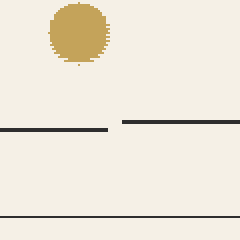
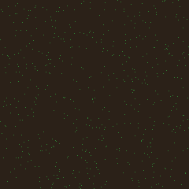
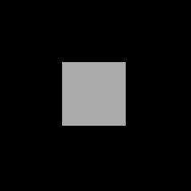

# cellular-automata

[](https://github.com/dlagrava/cellular-automata/actions/workflows/ci.yml)
[](LICENSE)

Java 21 library for building and evolving 2D cellular automata, plus a JavaFX demo and a headless CLI batch runner.

Licensed under the [GNU GPLv3](LICENSE).

Rules live in a UI-free `core` module. Display goes through `IExporter` (integer grids → pixels or files), so the same automata can drive Swing, JavaFX, or other front ends. Batch runs use `IStatsCollector` for CSV / frame output without a UI.

| Falling Sand | Forest Fire | Time Tunnel |
|:------------:|:-----------:|:-----------:|
|  |  |  |

## Modules

```text
cellular-automata/
  core/      # publishable library (no JavaFX)
  display/   # ColorMap, ImageWriter
  examples/  # concrete rules
  cli/       # headless batch runner
  demo/      # JavaFX app
```

| Module | Role |
|--------|------|
| **core** | Setup, neighborhoods, boundaries, lookup tables, evolutionary CA engines, `IExporter`, `IStatsCollector` |
| **display** | `ColorMap`, `ImageWriter` |
| **examples** | Concrete rules (`GameOfLife`, `HPP`, …) |
| **cli** | Headless batch: run a CA for N steps with pluggable stats collectors |
| **demo** | JavaFX shell: pick a CA, play / pause / step / reset, optional HPP side panel |

### Genetic CA (`evolutionaryAutomata`)

Each cell owns a lookup-table genome. Fitness counts resource consumption (`1→0`); every few steps, below-mean cells adopt a crossover offspring with their fittest neighbor (optional bit-flip mutation). Export shows each LUT as an integer so rule diversity is visible.

```java
GeneticCellularAutomata genetic = new GeneticCellularAutomata(
        size, size, setup, evolutionStep, false); // optional StartingPattern
genetic.initializeRules(RuleDistribution.HORIZONTALSPLIT, rule1, rule2);
genetic.selectCrossoverType(CrossoverType.UNIFORM, 0.5); // or ONEPOINT / TWOPOINT
// genetic.selectMutation(0.01); // optional, off by default
```

## Requirements

- JDK 21
- A display for the JavaFX demo

## Run the demo

```bash
./gradlew :demo:run
```

The window lists Game of Life, Falling Sand, Langton’s Ant, HPP, Parity, Time Tunnel, West, and Genetic CA. Use Play / Pause / Step / Reset, size, and speed. Selecting HPP shows reverse, add-particle, and iteration controls.

## Batch / CLI

Headless runs (no JavaFX): pick a CA, step count, and collectors (`density`, `histogram`, `genetic-rules`). Optional `--frames` writes GIFs; `--out` writes CSV (stdout if omitted).

```bash
./gradlew :cli:run --args='--ca game-of-life --size 200 --steps 500 --collect density,histogram --out out/run.csv'
```

Build the library jar alone:

```bash
./gradlew :core:jar
```

## Add a cellular automaton

1. Subclass `IntegerCellularAutomata2D` in `examples` (package `cellularautomata.examples`).
2. Construct a `Setup` with the boundary and neighborhood you need.
3. Implement `applyRule(int x, int y, int[] values)` — `values[0]` is the cell; the rest are neighbors in neighborhood order.
4. Export state with `exportValues(IExporter)` (demo uses `CanvasExporter`; `ImageWriter` writes files).
5. Wire into `demo` via `DemoApp`’s picker + factory and a `ColorMap` from `display`.

Minimal sketch:

```java
public class MyRule extends IntegerCellularAutomata2D {
    public MyRule(int sizeX, int sizeY, Setup setup) {
        super(sizeX, sizeY, setup);
        // initialize cells…
    }

    @Override
    public int applyRule(int x, int y, int[] values) {
        // return next state for (x, y)
        return values[0];
    }
}
```
